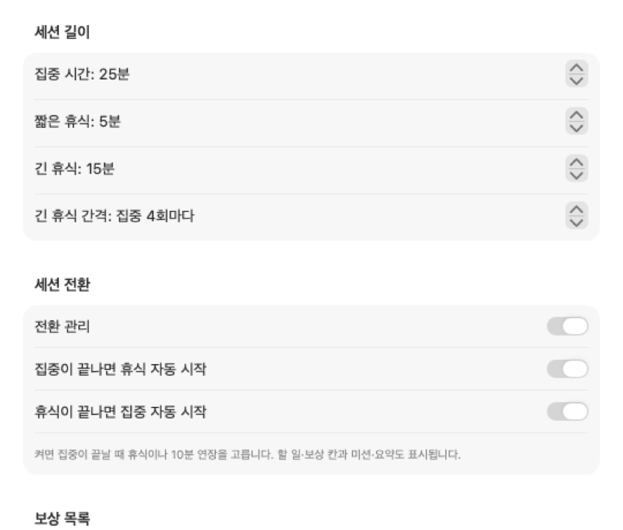
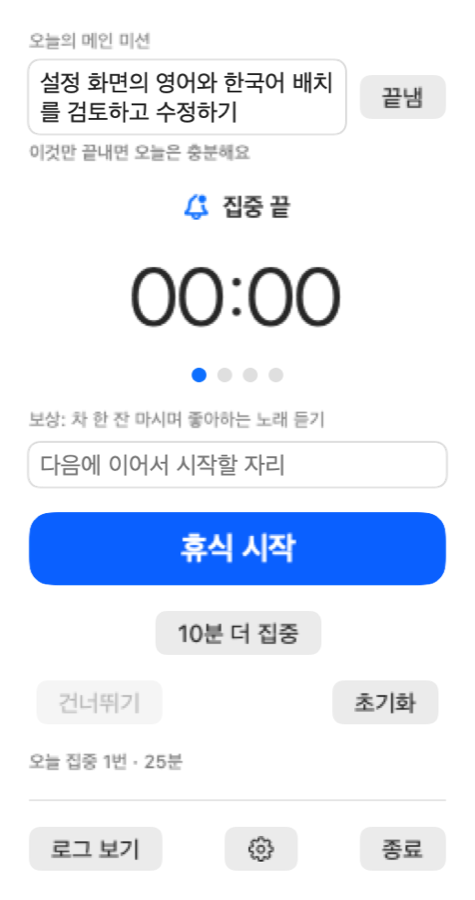
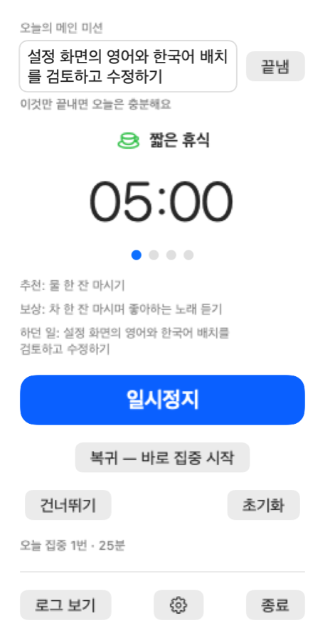
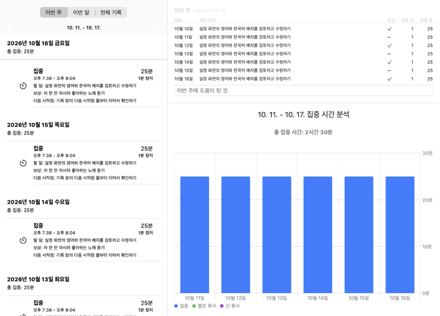

[English](GUIDE.md) | 한국어

# Morrowisp 처음 사용하기

한 가지를 정하고, 집중하고, 쉰 뒤 다시 시작할 자리를 남겨 보세요.

## 설치

[README의 설치 안내](../Readme.ko.md#설치)를 따라 설치한 뒤 Morrowisp를 엽니다.

## 메뉴 막대 아이콘 열기

macOS 메뉴 막대에서 Morrowisp 아이콘을 누릅니다. 열리는 작은 창이 팝오버입니다. 타이머와 **로그 보기**, **설정**을 여는 톱니바퀴 단추가 있습니다.

## 첫 집중 시작하기

**시작**을 누르고 한 가지 일에 집중해 보세요. 잠깐 멈출 때는 **일시정지**, 이어서 할 때는 **재개**를 누릅니다. 집중과 휴식 시간은 **설정 > 타이머 > 세션 길이**에서 조절합니다.

## 전환 관리 켜기

톱니바퀴 단추로 **설정 > 타이머**를 열고 **전환 관리**를 켭니다. 할 일과 보상 칸, 하루의 미션과 요약, 집중이 끝났을 때의 선택이 표시됩니다.

## 하루 흐름 예시

**아침.** **오늘의 메인 미션**에 “소개 글 초안 쓰기”처럼 오늘 끝내고 싶은 한 가지를 적습니다. **할 일**에는 “첫 문단 쓰기”처럼 작은 단계를, **끝나면 받을 보상**에는 “차 한 잔”을 적고 집중을 시작합니다.

**집중이 끝나면.** **다음에 이어서 시작할 자리**에 “두 번째 문단 뒤에 예시 넣기”처럼 다음 시작점을 남깁니다. **휴식 시작**이나 **10분 더 집중**을 고릅니다.

**휴식 중.** **추천**에 나온 짧은 휴식 거리를 해 보세요. 준비가 되면 **복귀 — 바로 집중 시작**을 누릅니다. 휴식을 마치고, 적어 둔 할 일과 다음 시작점 그대로 바로 집중을 시작합니다.

**저녁.** 메인 미션을 마쳤다면 **끝냄**을 누릅니다. 팝오버에서 오늘 마친 집중 수, 집중 분, 연장 횟수와 주로 한 일을 돌아봅니다. **로그 보기**를 열어 **이번 주**를 살펴보고 **이번 주에 도움이 된 것**에 짧은 메모를 남깁니다. 회고에는 오늘까지 지난 7일이 표시됩니다.

## 보상 목록 만들기

전환 관리를 켠 상태에서 **설정 > 타이머 > 보상 목록**을 엽니다. **작은**, **중간**, **큰** 옆의 **+** 단추로 항목을 더하고 이름을 고칩니다. 음악 한 곡, 산책, 취미 시간처럼 적어 보세요.

팝오버로 돌아와 **끝나면 받을 보상** 칸 옆 단추를 누르면 보상 목록과 지난 보상에서 고를 수 있습니다. 직접 적어도 됩니다.

## 기록 창 살펴보기

**로그 보기**를 누르면 **집중 기록** 창이 열립니다. **이번 주**, **이번 달**, **전체 기록** 중에서 고릅니다. 주·월 화면에는 세션 기록과 일별 차트가, **전체 기록**에는 전체 통계와 월별 차트가 표시됩니다. 화살표로 이전 주나 달을 살펴볼 수 있습니다.

## Obsidian · 단축어 연결하기

세션 기록을 데일리 노트에 남기려면 [Obsidian 가이드](OBSIDIAN.ko.md)를, 집중 시작과 끝에 macOS 단축어를 실행하려면 [단축어 가이드](SHORTCUTS.ko.md)를 따라 설정합니다.

## 업데이트

새 버전이 있으면 메뉴 막대 아이콘에 점이 나타납니다. 팝오버를 열어 새 버전 안내 줄의 **업데이트**를 누릅니다. 이미 받아 둔 버전이면 설치하고 앱을 다시 켜며, 아직 받지 않았다면 새 버전 안내 창을 엽니다. 받아 둔 업데이트는 앱을 종료할 때도 설치됩니다.

업데이트 설정은 **설정 > 일반 > 업데이트**에 있습니다.

## 자주 묻는 것

- **알림이 안 와요.** macOS **시스템 설정 > 알림**에서 Morrowisp의 알림을 허용하세요.
- **로그인할 때 켜고 싶어요.** **설정 > 일반**에서 **로그인 시 자동 실행**을 켭니다.
- **언어는 어떻게 바꾸나요?** 시스템 언어를 따릅니다. 영어와 한국어를 지원하며, 그 밖의 언어에서는 영어로 표시합니다.
- **기록은 어떻게 지우나요?** 기록 창의 휴지통 단추인 **모든 로그 삭제**를 누르고 **삭제**로 확인합니다.
