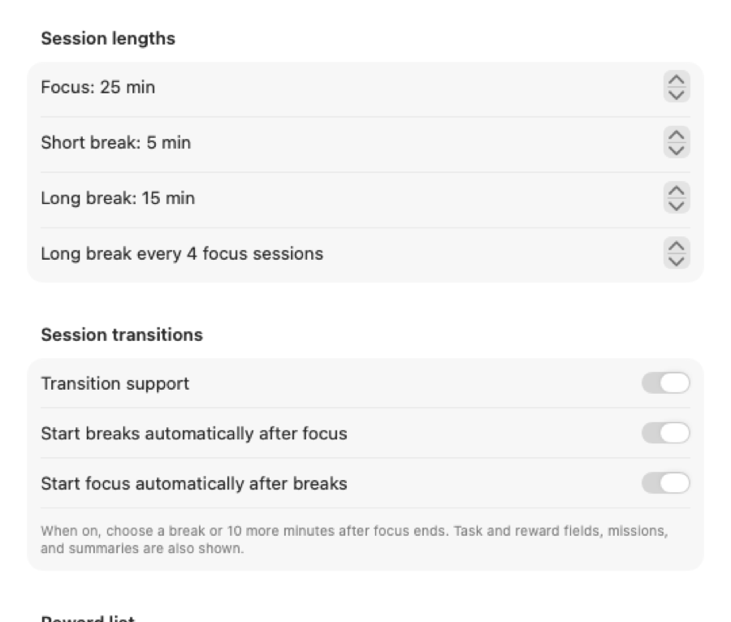
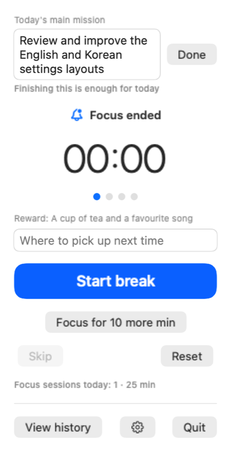
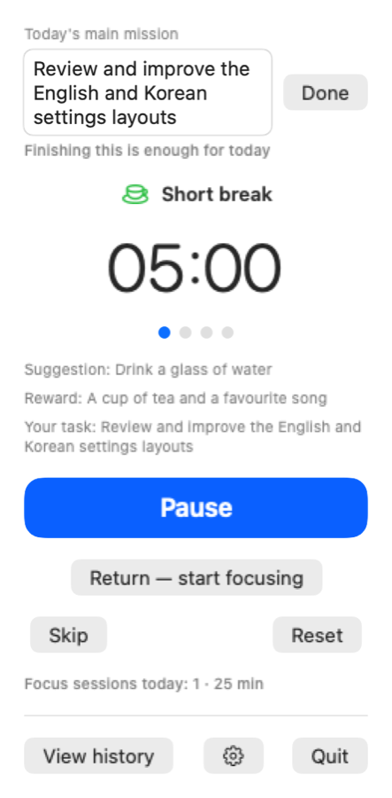
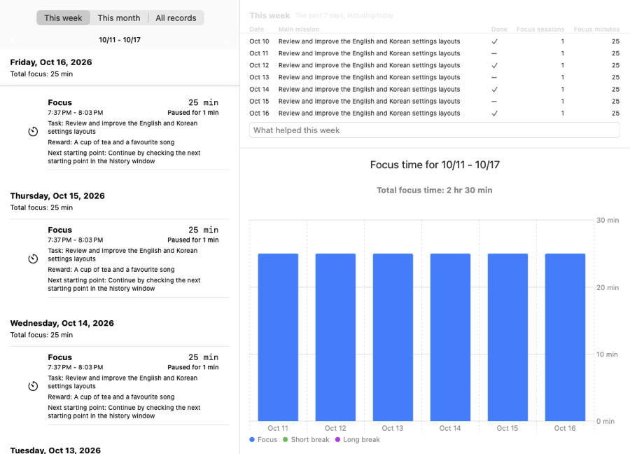

English | [한국어](GUIDE.ko.md)

# Getting started with Morrowisp

A small routine: choose one thing, focus, rest, and leave yourself a place to return to.

## Install

Follow the [README installation instructions](../Readme.md#install), then open Morrowisp.

## Open the menu bar icon

Click the Morrowisp icon in the macOS menu bar. The small window that opens is the popover: it holds the timer, **View history**, and the gear button for **Settings**.

## Your first focus session

Click **Start** and work on one thing. Use **Pause** when needed and **Resume** to continue. You can adjust focus and break lengths under **Settings > Timer > Session lengths**.

## Turn on transition support

Open the gear button, then **Settings > Timer**, and turn on **Transition support**. This shows task and reward fields, a daily mission, summaries, and a choice when focus ends.

## A day with Morrowisp

**Morning.** Under **Today's main mission**, write one thing you would like to finish, such as “Draft the introduction.” In **Task**, write a smaller step, such as “Write the opening paragraph.” Add something to **A reward for when you finish**, such as “Tea,” then start focusing.

**When focus ends.** Write a next starting point in **Where to pick up next time**, such as “Add an example after paragraph two.” Choose **Start break** or **Focus for 10 more min**.

**During a break.** Try the short idea beside **Suggestion**. When you are ready, **Return — start focusing** ends the break and starts focus immediately, keeping your task and next starting point.

**Evening.** Mark your main mission **Done** if you finished it. Review today's summary in the popover: completed focus sessions, focus minutes, extensions, and your most frequent task. Open **View history**, look at **This week**, and leave a short note in **What helped this week**. The reflection shows the past seven days, including today.

## Keep a reward list

With transition support on, open **Settings > Timer > Reward list**. Use the **+** button beside **Small**, **Medium**, or **Large** to add an item, then edit its name. For example: a song, a walk, or time for a hobby.

Back in the popover, use the button beside **A reward for when you finish** to choose from your list and past rewards. You can also type a reward directly.

## Look back at your history

Click **View history** to open **Focus history**. Choose **This week**, **This month**, or **All records**. The week and month views show session records and daily charts; **All records** shows overall statistics and a monthly chart. Use the arrows to browse earlier weeks or months.

## Connect Obsidian and Shortcuts

To write session records to daily notes, follow the [Obsidian guide](OBSIDIAN.md). To run a macOS shortcut when focus starts or ends, follow the [Shortcuts guide](SHORTCUTS.md).

## Update the app

A dot on the menu bar icon indicates a new version. Open the popover and click **Update** on the new-version row. If it is already downloaded, the app installs it and reopens; otherwise, the new-version window opens. A downloaded update also installs when you quit.

Update controls are under **Settings > General > Updates**.

## Common questions

- **Why am I not getting notifications?** Allow Morrowisp notifications in macOS **System Settings > Notifications**.
- **Can it open when I log in?** Turn on **Launch at login** under **Settings > General**.
- **How do I change the language?** Morrowisp follows your system language. It supports English and Korean; other languages use English.
- **How do I clear history?** In the history window, use the trash button, **Delete all records**, then confirm with **Delete**.
